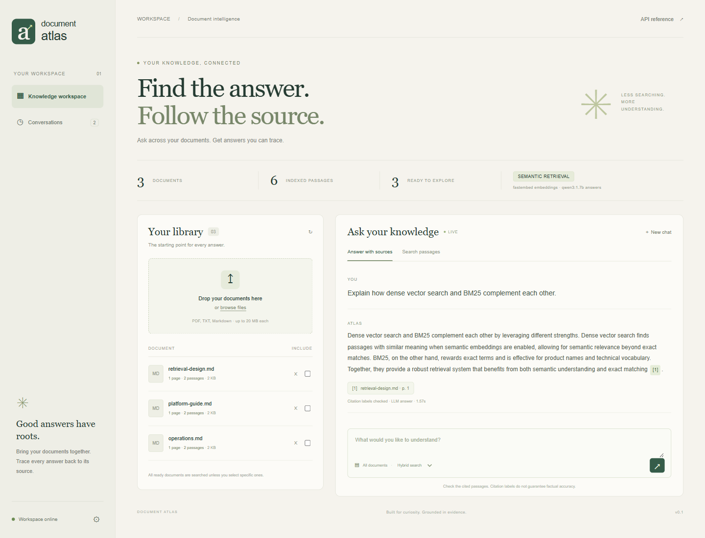

# Document Atlas

An intelligent document retrieval platform with local semantic search, citation-aware answers, persisted conversation memory, and streaming.

**Python · FastAPI · SQLAlchemy · PostgreSQL · ChromaDB · FastEmbed · Ollama · OpenAI APIs · Docker**



## Run this prepared workspace

The verified Docker workspace is running with PostgreSQL, HTTP ChromaDB, FastEmbed semantic embeddings, semantic chunking, and genuinely generated answers from local Qwen3 through Ollama. No paid API credentials are needed.

```powershell
.\scripts\start-ollama.ps1 -PullModel
docker compose up -d
```

Open [the Docker workspace](http://127.0.0.1:8002) or [API documentation](http://127.0.0.1:8002/docs). This prepared machine uses `ATLAS_PORT=8002` because port 8000 is occupied. Fresh clones default to 8000. Upload your documents or seed the examples:

```powershell
.venv\Scripts\python.exe scripts/demo.py --base-url http://127.0.0.1:8002
```

[Current verification and remaining work](docs/STATUS.md).

For development without Docker, the installed virtual environment and downloaded model are also available. Run `.\scripts\start.ps1` for SQLite and embedded Chroma on port 8000; `-Port 8003` chooses another port. Local and Docker data are separate.

## Fresh installation

Use Python 3.12 or 3.13 and uv:

```powershell
uv sync --frozen --python 3.12 --extra dev --extra local
Copy-Item .env.example .env
uv run uvicorn app.main:app --host 127.0.0.1 --port 8000 --workers 1
```

The example config uses deterministic lexical hash vectors and extractive answers: no download or credentials. The UI explicitly labels this demo, which does not understand synonyms.

For real local semantic retrieval, edit `.env` and restart:

```dotenv
ATLAS_EMBEDDING_PROVIDER=fastembed
ATLAS_EMBEDDING_MODEL=BAAI/bge-small-en-v1.5
ATLAS_CHUNK_STRATEGY=semantic
ATLAS_LLM_PROVIDER=extractive
```

Download once with `uv run python scripts/prefetch_model.py`. Reindex existing documents after changing model or chunking settings; the UI marks incompatible indexes.

## Features

- PDF, UTF-8 text, and Markdown ingestion with duplicate detection, page provenance, progress states, retries, and restart recovery.
- Sentence or semantic boundary chunking with overlap and a hard word limit.
- Local ONNX or OpenAI embeddings stored in versioned Chroma indexes.
- Hybrid BM25/vector retrieval with reciprocal rank fusion, document filters, and duplicate suppression.
- Real streamed LLM answers from local Ollama or the OpenAI Responses API, plus an extractive fallback.
- Page-level citation objects, structural citation checks, and clickable source dialogs.
- Saved conversations, bounded memory, and transparent follow-up query expansion.
- Upload limits, optional API-key access, request IDs, migrations, tests, dependency lock, Compose, and CI configuration.
- Reproducible retrieval evaluation with question-level evidence.

## Enable LLM answers

For local answers, install [Ollama](https://ollama.com/download), start the model service, and download the model once:

```powershell
.\scripts\start-ollama.ps1 -PullModel
```

```dotenv
ATLAS_LLM_PROVIDER=ollama
ATLAS_LLM_MODEL=qwen3:1.7b
```

Restart the API after changing providers. Native API execution uses `http://127.0.0.1:11434`; Docker Desktop uses `http://host.docker.internal:11434`. Set `ATLAS_OLLAMA_BASE_URL` explicitly for other reachable Ollama deployments. The helper starts a localhost-only service with cloud features disabled and stores models under ignored `data/ollama`. If another Ollama service is already running, it is reused and its existing model directory/configuration applies. `-PullModel` downloads only when the selected model is missing; the prepared workspace already has it.

The local model has been exercised through five [real end-to-end probes](evaluation/local-llm-smoke.json), including a paraphrase, follow-up, document filtering, and refusal of an unanswerable question. Those small synthetic checks do not establish general accuracy. First model loading can be slow; warm requests vary with hardware and context. Input packing conservatively bounds local context, and SSE comments keep slow generation streams alive. Ollama's protocol is documented in its [chat API](https://docs.ollama.com/api/chat) and [streaming guide](https://docs.ollama.com/api/streaming).

To use OpenAI instead, keep local embeddings and change generation settings:

```dotenv
ATLAS_LLM_PROVIDER=openai
ATLAS_LLM_MODEL=gpt-4.1-mini
OPENAI_API_KEY=your-key
```

For OpenAI embeddings, also choose `ATLAS_EMBEDDING_PROVIDER=openai` and `ATLAS_EMBEDDING_MODEL=text-embedding-3-small`, then reindex. Embedding and generation providers are independent. These settings make paid API calls and send applicable passages/questions/history to OpenAI. No paid calls were used in implementation or testing. The adapter follows official [streaming](https://developers.openai.com/api/docs/guides/streaming-responses) and [embedding](https://developers.openai.com/api/docs/guides/embeddings) documentation.

Switch generation back to `ATLAS_LLM_PROVIDER=extractive` for evidence quotes without running an LLM. Changing only generation does not require document reindexing.

## PostgreSQL and Docker

```powershell
docker compose up --build -d
docker compose logs -f api
```

Compose configures PostgreSQL and HTTP Chroma with persistent named volumes. Only the API port is exposed, on localhost. Provider settings come from `.env`; database/vector addresses use service networking. Migrations run at startup. Use exactly one API process because locks are process-local.

The default database password is for local development. Configure `POSTGRES_PASSWORD`, `ATLAS_API_KEY`, TLS, and user/document authorization before deployment beyond your own machine. Stop containers with `docker compose down`, which retains data.

The stack has been tested against actual PostgreSQL and HTTP Chroma, including PDF page citations, streaming, filtering, conversations, source-file reindexing, and deletion. All three containers were recreated and the retained source files, vectors, and history survived through named volumes. [Smoke results](evaluation/container-smoke.json), [runtime versions](evaluation/container-environment.json), and [container lifecycle evidence](evaluation/container-lifecycle.json) record the checks. Dependency download caches use BuildKit cache mounts rather than being shipped in the runtime image.

`ATLAS_PORT` selects the host API port. `compose.integration.yaml` optionally exposes PostgreSQL on loopback port 5433 and Chroma on 8001 for host-run tests; normal Compose leaves those services private.

## API

```powershell
curl.exe -F "file=@samples/platform-guide.md" http://127.0.0.1:8000/api/documents
```

```http
POST /api/chat/stream
Content-Type: application/json

{"query":"How does ingestion work?","top_k":5,"mode":"hybrid","document_ids":[]}
```

Streams emit `sources`, `delta`, and `done`, or an `error`. A connection without `done` is incomplete. Pass the returned `conversation_id` for follow-ups. Citations contain filename, page, chunk ID, and the exact bounded context excerpt. `grounded` means citation labels passed structural validation, not that entailment or factual accuracy was proven.

| Route | Purpose |
| --- | --- |
| `GET /api/health` | SQL, vector-service, and worker readiness |
| `GET /api/config`, `/api/stats` | Providers and workspace counts |
| `POST /api/documents` | Upload and enqueue; returns 202 |
| `GET /api/documents` | Paginated library |
| `GET /api/documents/{id}` | Ingestion state/error |
| `GET /api/documents/{id}/chunks` | Source passage inspection |
| `POST /api/documents/{id}/reindex` | Retry or rebuild |
| `DELETE /api/documents/{id}` | Remove source, SQL chunks, active vectors |
| `POST /api/search` | Hybrid, vector, or keyword search |
| `POST /api/chat`, `/api/chat/stream` | Cited answers and memory |
| `GET /api/conversations`, `/api/conversations/{id}` | Saved conversations |
| `DELETE /api/conversations/{id}` | Remove conversation and messages |

Set `ATLAS_API_KEY` to protect data routes with `X-API-Key`. Enter it via browser workspace settings or the API reference's Authorize button. Health/static assets stay public. There are no user accounts or per-document ACLs. The docs pages load their UI bundles from jsDelivr with a documentation-only content security policy; the main workspace retains its same-origin policy.

## Test and evaluate

```powershell
uv run ruff check app tests scripts
uv run ruff format --check app tests scripts
uv run pytest --cov=app --cov-report=term-missing
uv run python -m app.evaluation --local --mode all --output evaluation/latest.json
```

Evaluation seeds a disposable workspace and measures Recall@k, Precision@k, MRR, nDCG, hit rate, and retrieval latency. [Hash](evaluation/hash-baseline.json) and [semantic](evaluation/semantic-baseline.json) baselines contain configuration and individual results. Both hybrid runs found all twelve labeled sample passages within the top five. This tiny synthetic corpus is a smoke test, not evidence of general accuracy, production scale, or end-to-end LLM latency.

The same benchmark has also run against the [containerized PostgreSQL/Chroma deployment](evaluation/container-baseline.json). A repeatable `scripts/verify_deployment.py` probe and container recreation job are included in CI; see the development guide for commands.

The [real-document benchmark](docs/BENCHMARK.md) adds ten pinned public NIST PDFs (515 physical pages) and 60 questions, including paraphrases and unanswerable questions. It separates development and test question documents, freezes mode selection before test queries, and retains per-question evidence and failures. Its evidence-anchor hit rates measure retrieval, not generated-answer correctness or citation entailment. The [manifest](evaluation/nist-v1/manifest.json), [questions](evaluation/nist-v1/questions.json), and [frozen protocol](evaluation/nist-v1/protocol.json) are versioned; source PDFs remain under ignored data storage.

The [reference run](evaluation/nist-v1/RESULTS.md) indexed 1,226 chunks. Hybrid was selected on development MRR and found frozen anchors for 27/35 answerable test questions (77.1% hit@5); keyword found 28/35 (80.0%). [Miss review](evaluation/nist-v1/RETRIEVAL_REVIEW.md) identifies both ranking failures and valid alternative evidence missing from the labels. A separate [14-answer local-LLM review](evaluation/nist-v1/ANSWER_REVIEW.md) records wrong and unsupported claims despite valid citation labels. It is an agent review of a small sample, not an independent answer-accuracy measurement.

```powershell
uv run python -m app.benchmark --download --validate-only
uv run python -m app.benchmark --base-url http://127.0.0.1:8002
```

Use port 8000 for a fresh default instance. Full runs retain the corpus for browsing; use `--cleanup` to remove only documents newly created by that run. Use new `--output` and `--state` paths for repeats. No LLM is called; OpenAI embeddings require explicit `--allow-paid`.

See [development](docs/DEVELOPMENT.md), [architecture](docs/ARCHITECTURE.md), and [portfolio/interview notes](docs/PORTFOLIO.md).

## Boundaries

Scanned PDFs need OCR; complex table/layout extraction is not implemented. BM25 scans at most 20,000 chunks. Ingestion supports one API process. Citation checks validate labels, not claims. Prompt injection is mitigated with instructions, not solved. Document deletion preserves citation excerpts saved in conversations; delete those separately. Old embedding collections also need explicit retention handling.

This is a runnable portfolio foundation, not a publicly deployed multi-tenant service.
