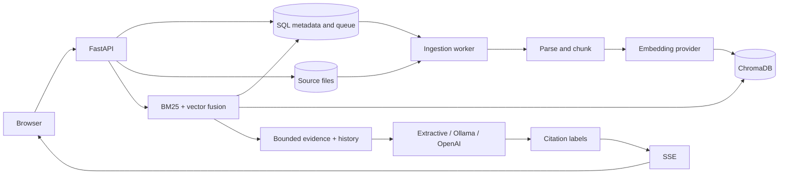

# Architecture

FastAPI serves the UI and REST API. SQL owns document state, chunks, conversations, and messages. Chroma stores vectors and metadata. Local development uses SQLite/embedded Chroma; Compose configures PostgreSQL/HTTP Chroma.

## Consistency and recovery

Uploads use generated UUID storage paths, streamed byte limits, SHA-256 deduplication, and atomic file rename before SQL enqueue. The worker commits processing state, parses with page provenance, chunks and embeds, replaces vectors, then commits SQL chunks and ready state together.

SQL and Chroma have no distributed transaction. Only ready SQL chunks with the current index signature can be retrieved. Partial/stale vectors stay invisible. Failures clear partial data and retain safe error messages. Startup requeues processing jobs and finishes interrupted deletions. Replacing vectors makes job replay safe. A hard crash before the upload SQL commit can leave an orphan source; this cleanup is not automated.

Mutation and conversation locks are process-local. Run one API process. Multiple workers require distributed claims/leases and conversation ordering.

## Chunking and index identity

Chunks preserve pages, bound words, and overlap. Oversized sentence units are split. Semantic mode embeds adjacent units and splits on a similarity drop after enough new content. It is a lightweight boundary heuristic, not a layout parser.

A signature hashes provider, model, algorithm version, strategy, word limit, overlap, and threshold. Each signature has a separate Chroma collection. Changes require reindexing; equal-dimensional vectors from incompatible models cannot mix. Old collections remain until explicit cleanup. Deletion touches the active collection.

Words are not exact model tokens. Token-dense code/URLs/multilingual passages can still be truncated by the embedding tokenizer.

## Retrieval

BM25 scans bounded eligible SQL text. Chroma searches filter to ready document IDs. Reciprocal rank fusion merges ranks with `1 / (60 + rank)`; token-set Jaccard similarity suppresses duplicates. Scores are not probabilities.

Default vector cutoffs: hash 0.2, FastEmbed 0.6, OpenAI 0.3. Tune ATLAS_MIN_VECTOR_SIMILARITY using representative labels. Python BM25 has a 20,000-chunk cap; larger systems need a sparse/full-text index.

## Generation, memory, and citations

Context has passage and character limits. History includes at most six previous turns by default with per-message truncation. Pronoun references/explicit follow-ups expand the query with the previous question; responses expose that query. This heuristic cannot resolve arbitrary dependencies.

OpenAI Responses streaming forwards deltas, sets store=False, and requires response.completed. Instructions require source-only answers and treating document instructions as untrusted. This does not guarantee prompt injection resistance. Extractive mode ranks and quotes evidence and is clearly labeled.

Ollama uses its local NDJSON chat API. Only content fields are forwarded; thinking fields are not displayed. Generation has bounded output and explicit context limits, and requires a completed stop event. Token-limit truncation, malformed responses, transport errors, or an interrupted stream never count as a completed answer. HTTP connections close when a client cancels.

The small local model uses a conservative UTF-8 byte estimate for input packing, with reserves for output/template overhead. History is shortened and evidence is fitted while retaining exact source prefixes in the returned citations. This intentionally underuses some token capacity and is not a universal tokenizer proof. Oversized questions are rejected rather than silently truncating the question. OpenAI context handling retains the existing configurable character/history limits.

Citation checks validate label membership in supplied context. grounded=true does not establish entailment, relevance, accuracy, or claim coverage. Citation excerpts match the bounded context sent to generation.

Completed user/assistant pairs commit together. Failure/cancellation before completion saves no half-turn. One response runs per conversation; deleting an active conversation returns 409. Separate conversations can generate concurrently.

## Streaming

POST /api/chat/stream emits sources, delta, then done. Generation failure emits error without done. Input, missing-conversation, and concurrency errors return HTTP errors before streaming. A stream without done is incomplete. While awaiting model output, keep-alive SSE comments are sent every ten seconds by default. Clients should ignore comment-only frames. Retrieval finishes before sources, so cold embedding initialization can still delay the first event.

## Security and retention

The optional shared API key protects one workspace, not users/documents independently. Health/static routes remain public. Browser keys use session storage; output uses DOM text nodes and a same-origin content security policy. No cookie authentication/CORS is enabled. OpenAPI describes the API-key header so Swagger's Authorize button can supply it. Only /docs and /redoc allow jsDelivr UI bundles and inline styles; bootstrap scripts receive a fresh per-response nonce. These pages use no-store caching, a local favicon, and no external schema validator. Documentation UI assets require internet access; workspace assets remain local.

Parsing is bounded but in-process. Hostile public uploads need isolated parsing. OpenAI selection sends applicable source/history data externally; store=False is not a zero-retention guarantee. Deletion removes current source/chunks/vectors, but conversation snapshots, old indexes, and backups have separate retention. Public/team use still needs TLS, identity/ACLs, rate limits, managed secrets, backups, and monitoring.
